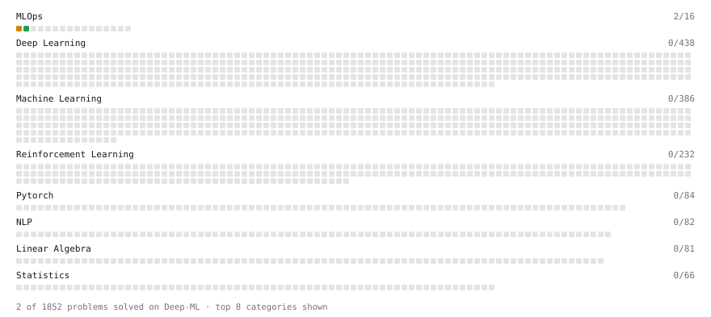

# Deep-ML

My machine learning practice from [Deep-ML](https://www.deep-ml.com). Every solution here was written by hand.

**5** solved · 5 problems · 0 labs · 0 math

[**Browse the interactive portfolio**](https://rishikaushal2009.github.io/deep-ml/) to replay this filling in over time.

## Problems

| | Difficulty | Solved | |
| --- | --- | --- | --- |
| [Binary Classification with Logistic Regression](https://www.deep-ml.com/problems/104) | easy | 2026-10-30 | [solution](problems/0104-binary-classification-with-logistic-regression) |
| [Calculate Model Inference Statistics for Monitoring](https://www.deep-ml.com/problems/248) | easy | 2026-10-29 | [solution](problems/0248-calculate-model-inference-statistics-for-monitoring) |
| [Build a Simple ETL Pipeline (MLOps)](https://www.deep-ml.com/problems/187) | medium | 2026-10-29 | [solution](problems/0187-build-a-simple-etl-pipeline-mlops) |
| [Implement Request Batching for Inference](https://www.deep-ml.com/problems/297) | medium | 2026-10-31 | [solution](problems/0297-implement-request-batching-for-inference) |
| [K-Means Clustering](https://www.deep-ml.com/problems/17) | medium | 2026-10-30 | [solution](problems/0017-k-means-clustering) |

---

_This file is regenerated by Deep-ML on every push._
